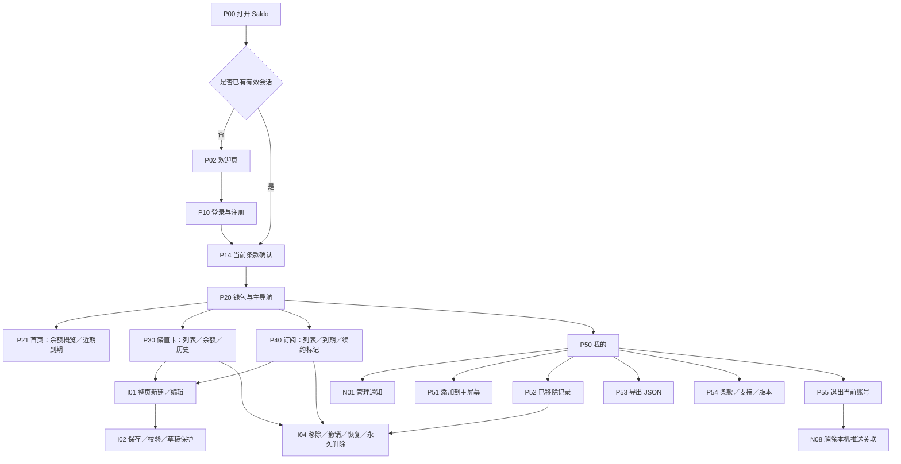
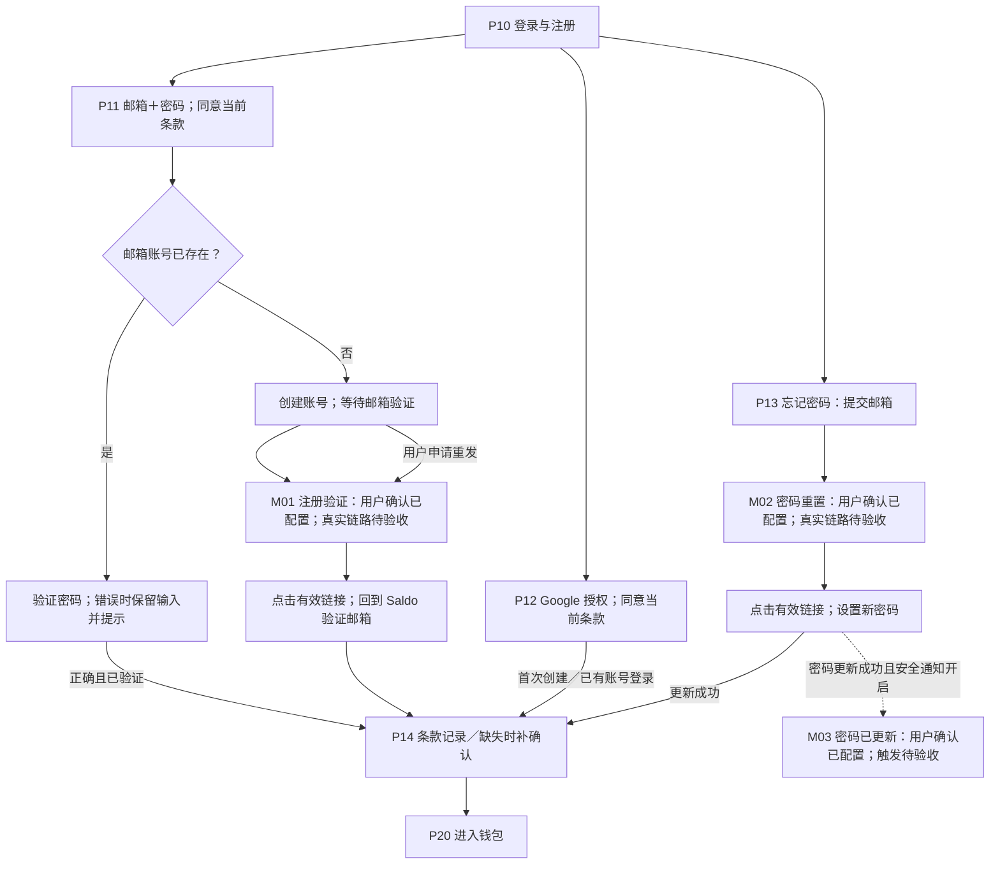
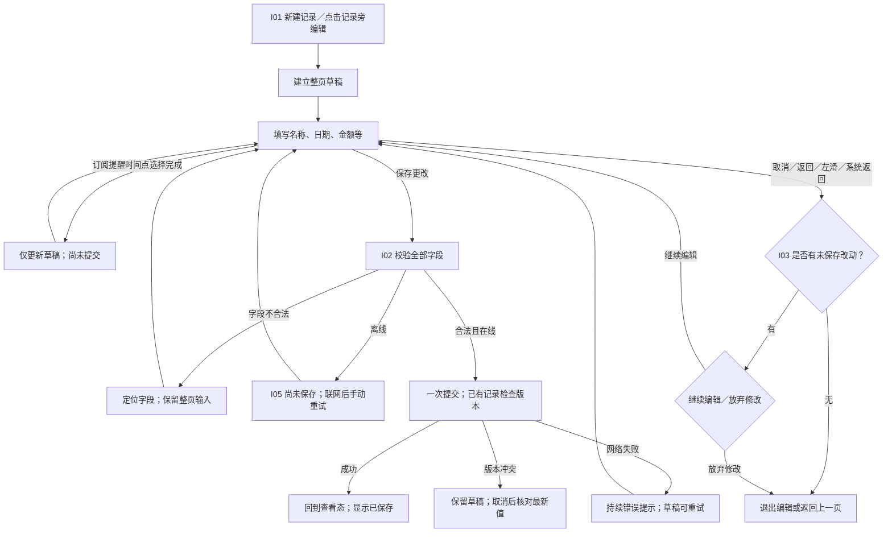
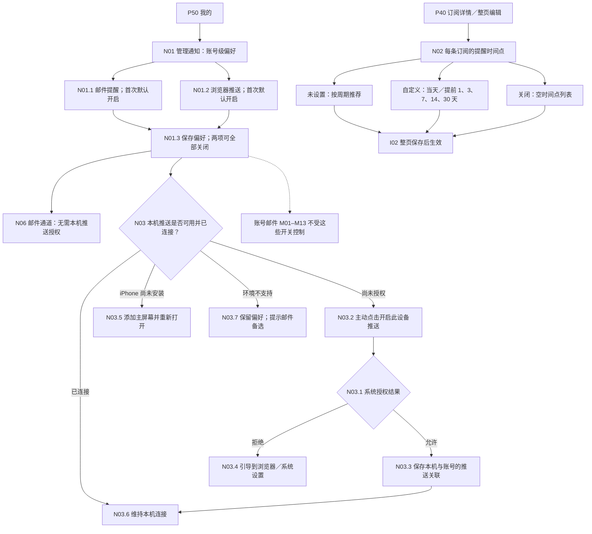
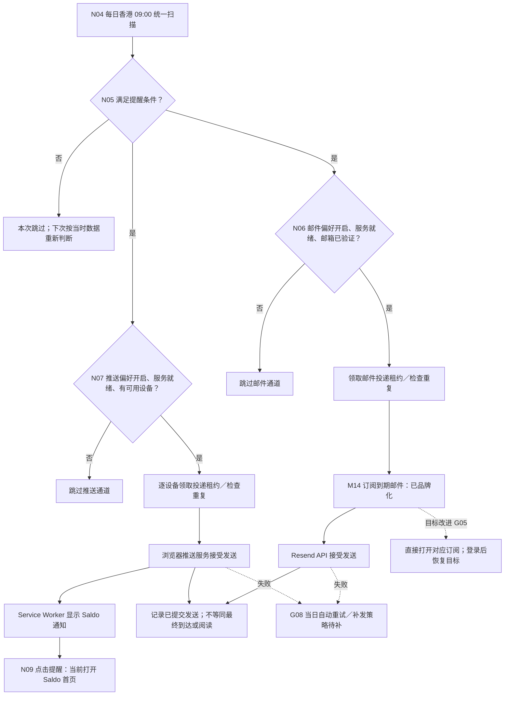

# Saldo 产品 PRD 与逻辑图 v1.2

日期：2026-11-21（香港时间）。代码发布基线：GitHub main c546080；PWA 静态资源沿用 2026.11.20.2，提醒函数 saldo-notifications v19。

本文件是后续产品需求与交互讨论的固定参照，原有编号保持不变。本轮同步已确认邮件规范、正式部署与 M01–M03 控制台配置进度。用户已逐项确认 M01、M02、M03 配置完成；真实收信与链接生命周期尚待验收，详见 [账号邮件验收](auth-email-acceptance-20261121.md)。

## 当前发布与验收基线

| 项目 | 当前状态 | 证据边界 |
| --- | --- | --- |
| GitHub | c546080 已提交到 main | 发布文件内容已核对；本轮 PRD 状态同步为后续文档更新 |
| Cloudflare Workers | 对应提交构建成功，正式部署 100% | 首页与 app.js 返回 200，内容与既有静态资源一致；未升级前端版本 |
| M14 到期提醒 | saldo-notifications v19 ACTIVE | 部署后源码读回一致；diagnostics HTTP 200，邮件／推送配置及定时开关均为 true |
| M01 注册验证 | 控制台配置完成（用户确认） | 最新主题与正文由用户确认保存；未独立读取 Auth 配置，未完成本轮真实注册验收 |
| M02 密码重置 | 控制台配置完成（用户确认） | 最新主题与正文由用户确认保存；真实重置链接与新旧密码测试待完成 |
| M03 密码已更新 | 控制台配置完成（用户确认） | 用户按模板与安全通知开关步骤确认完成；未独立读回开关或验证实际触发 |
| M04–M13 其他条件邮件 | 本地品牌模板已齐；实际开启情况待核对 | 不视为全部开启，也不视为相应产品入口已开放 |
| G01–G03 | 部分完成，保持未关闭 | 配置确认、独立读回与真实业务验收分别记录 |

状态规则：设计确认 ≠ 已部署；用户确认配置完成 ≠ 独立读回；部署成功 ≠ 真实收信或操作链路通过。

## 0. 编号和状态规则

- P：功能模块；I：共用交互；N：通知规则；M：邮件场景；G：已识别缺口。
- C：研究候选功能，单独记录在竞品调研中；不代表已批准、已实现或已排期。
- 编号稳定保留，不随优先级调整而重排或重复使用。新增场景追加编号；停用编号保留并标注停用。
- “已实现”指当前代码已有；“已确认”指已取得相应线上证据；“待核验”不等于已开启、已关闭或已品牌化。
- 实线为当前产品路径；虚线为条件事件、未完成项或目标改进，须同时阅读标签。
- M01 重发验证沿用同一编号。M14 的提前多日／当天、不同订阅或多次触发也沿用同一编号，用参数区分。
- 当前没有独立的普通登录成功邮件或 Google 登录成功邮件；M06 是身份关联事件，不是每次授权登录。

## 1. 功能总览

| 编号 | 模块 | 范围 |
| --- | --- | --- |
| P00–P02 | 入口与欢迎 | 识别会话；未登录欢迎页与产品介绍。 |
| P10／P11／P12／P13／P14 | 账号 | 邮箱统一登录注册、Google 登录、找回密码、当前条款同意与验证回调。 |
| P20／P21 | 首页 | 余额汇总；未来 30 天有到期订阅才显示近期到期，并按日期排列。 |
| P30 | 储值卡 | 新建、查看、修改余额／有效期／备注；余额历史只读。储值卡有效期当前不触发 N04 提醒。 |
| P40 | 订阅 | 名称、费用、周期、到期日、自动续约标记、备注、提醒时间点。 |
| P50／P51／P52／P53／P54／P55 | 我的 | 通知、主屏幕安装、已移除记录、JSON 导出、条款／支持／版本、退出。 |
| I01／I02 | 整页表单 | 新建和编辑共用草稿、校验、取消和底部一次保存；提醒选择完成仅更新草稿。 |
| I03 | 导航与返回 | Tab 左右切换；二级页左滑返回；按钮／系统 Back 共用未保存保护；Tab 保留搜索、排序、滚动。 |
| I04 | 记录生命周期 | 移除不永久删除；10 秒撤销；已移除记录可恢复或永久删除；永久删除储值卡连同余额历史清理。 |
| I05 | 异常反馈 | 离线与失败保留当前页面输入；联网后手动重试；草稿目前不持久化、不自动同步。 |

## 2. 账号用户链路与邮件触发

M01、M02 的主题、HTML 与验证变量由 Supabase Auth 模板配置控制；通过已配置的 SMTP 发信。M14 由 Saldo 的 saldo-notifications Edge Function 渲染 HTML／纯文本，并调用 Resend Email API。Saldo 自有后台代码部署在 Supabase；Cloudflare Workers 托管 PWA 前端。

注册／找回流程的邮件链接需由 Auth 验证；有效、过期、重复使用、取消及跨设备行为均属于 G03 验收范围。M03 的配置完成依据用户确认，仍须验收实际触发；其余条件邮件以实际项目开关和触发事件为准，不推定为已开启。

## 3. 共用新建、编辑、保存与返回

I04 详细规则：移除记录后不计入首页活跃概况；已移除订阅不再进入 N04 扫描；可以撤销或在 P52 恢复。永久删除前确认，删除储值卡时连同余额历史清理。恢复订阅后只按下一次扫描时的日期与规则判断，不承诺补发过去的提醒。

I03：四个主 Tab 内左右滑动切换；详情／二级页左滑返回；弹层优先关闭；编辑与弹层的未保存内容优先确认。浏览器／系统 Back 与可见返回按钮共享保护。系统屏幕边缘手势保留；左滑返回是当前产品约定，并非宣称是所有平台的通用默认手势。

## 4. 通知：用户设置与设备授权

### N01 账号偏好

- 首次初始化时邮件与推送默认都为 true；已有选择不因再次登录而重置。
- 修改开关后点击“保存偏好”才持久化。允许任意组合，也允许全部关闭。
- N01 控制订阅到期提醒，不控制注册验证、重置密码或其他账号安全邮件 M01–M13。
- 关闭推送偏好不等于撤销操作系统权限，也不删除所有设备关联；服务器按账号偏好停止发送。
- 重新开启后，已有有效关联的设备可恢复参与发送；尚未授权的设备仍需 N03。

### N02 单条订阅规则

- 未自定义（NULL）：按月推荐提前 3、1 天；按年／两年及以上推荐提前 30、7、1 天；其他周期推荐提前 7、1 天。
- 可自选到期当天（0）或提前 1、3、7、14、30 天；空数组表示关闭此订阅的全部到期提醒。
- 弹层“完成”只更新整页草稿；I02“保存更改”后才生效。
- 关闭某条订阅的提醒对该订阅的邮件和推送均有效。
- 自动续约字段当前仅作记录并调整提醒文案；不代扣、不自动续费、不自动延后到期日。

### N03 本机设备状态

- 账号推送偏好开启不代表本机已授权或已连接。
- 用户主动点击按钮后申请系统通知权限；允许后还需保存设备订阅与当前账号的关联。
- iPhone 需添加到主屏幕并从安装的应用打开；Android 提供安装引导，是否可推送取决于浏览器与环境支持。
- 权限拒绝时引导系统／浏览器设置；环境不支持时保留偏好并提示可用渠道。
- N08 主动退出当前账号会解除本机推送关联；账号偏好和其他设备不因此全部关闭。
- 本机浏览器授权被撤销或设备关联失效后，即使偏好仍为开启，也不能保证本机收到推送。

## 5. 通知：后台判断与双通道投递

### N04 扫描时机

已只读核对任务 saldo-subscription-reminders：active=true，Cron 为 0 1 * * *，任务时区 GMT，即香港时间每日 09:00。

按每个账号已保存的时区判断今天日期。这不是每位用户当地时间 09:00 的独立任务。每日扫描后才新增或修改的订阅，下次扫描按当时日期重新判断，不默认补发已经错过的提醒时间点。

### N05 必须同时满足的条件

1. 定时发送总开关已开启，任务请求通过认证。
2. 订阅未移除、未永久删除、有到期日。
3. 已有账号通知偏好，且至少一个通道开启。
4. 按账号时区计算的“距到期日天数”命中 N02 时间点。
5. 对应通道的服务配置就绪；发送前再次读取偏好。
6. 邮件通道要求账号邮箱已验证；推送通道要求相应设备关联仍有效。

邮件和推送是独立通道；只满足其中一个通道时，可只发送该通道。某个通道失败不代表另一个必定失败。

### 去重、状态和失败边界

相同订阅、到期日、提前天数、通道和目标对应一条投递记录；数据库租约避免并发重复提交，邮件另使用 Resend 幂等键。租约为 10 分钟；它只控制领取资格，不会自行触发任务。

当前后台成功状态表示发送服务已接受请求。实际进收件箱、系统展示或用户阅读不能由 sent_at 推断。当前没有独立当日自动重试／补发任务，不应把 G08 画成已实现。

N09 当前提醒邮件按钮与推送点击都回到 Saldo 首页；直达具体订阅属于 G05，尚未实现。

## 6. 邮件编号目录

2026-11-21：M01–M13 的本地品牌稿均已备齐；用户已分别确认新版 M01、M02、M03 配置完成。其他实际开启邮件仍待确认类型及配置；下表的“待核验”不表示本地缺少设计稿。

M01–M14 的主题、摘要、事件信息、操作层级和异常说明遵循 [邮件内容规范](email-content-guidelines.md)；设计已获确认，M14 已部署到提醒函数 v19；M01–M03 已获用户配置确认，其余按实际开启情况跟进。详见 [邮件发布记录](email-release-20261121.md)。

### 邮件交互要求（已确认）

- 主题采用「Saldo · 事件摘要」；预览文案独立说明下一步；事件字段有值才展示，不编造时间、设备或 IP。
- M01／M02／M04／M09／M10 使用明确的金色操作按钮；M08 突出验证码，不增加跳转按钮。
- M03／M05–M07／M11–M13 属于安全事件：本人操作无需处理，不单独重复「打开 Saldo」；异常说明中就近提供实际需要的链接。
- 「联系 Saldo」在异常说明中出现时，直接链接 service@saldo.tobmarket.ing，页脚不重复入口；其余邮件保留页脚支持入口。
- M01／M02 的「返回 Saldo」直接链接正式站；不为尚未开放的流程编造深层链接。
- M14 的「管理通知偏好」只链接异常说明中的对应文字，页脚不重复；HTML 与纯文本均保持相同指引。
- 账号验证／安全邮件不受 N01 到期提醒开关控制；通知设置入口只适用于 M14。

| 编号 | 触发条件 | 邮件名称 | 品牌与配置状态 | 关联 |
| --- | --- | --- | --- | --- |
| M01 | 首次邮箱注册；用户重发验证 | 注册验证／重发同一邮件 | 用户确认最新模板配置完成；独立读回、真实收信与链接待验收 | P11、P14；不受 N01 控制 |
| M02 | 忘记密码后提交邮箱 | 密码重置 | 用户确认最新模板配置完成；真实 recovery 链路与新旧密码测试待验收 | P13；不受 N01 控制 |
| M03 | 密码更新成功，且安全通知开启 | 密码已更新通知 | 用户按模板与安全开关步骤确认配置完成；独立读回与真实触发待验收 | P13 后续安全通知 |
| M04 | 申请更换邮箱 | 邮箱变更确认 | 当前无产品入口；模板／设置待核验 | 账号扩展；条件场景 |
| M05 | 邮箱更换完成，且安全通知开启 | 邮箱已变更通知 | 当前无产品入口；模板／开关待核验 | 账号扩展；条件场景 |
| M06 | 登录方式关联，且安全通知开启 | 登录方式已关联 | 模板／开关待核验；并非每次 Google 登录都触发 | P12 相关的条件安全事件 |
| M07 | 登录方式解除，且安全通知开启 | 登录方式已解除 | 当前无解除入口；模板／开关待核验 | 账号扩展；条件场景 |
| M08 | 敏感操作要求再次验证身份 | 再次身份验证邮件 | 当前无独立产品入口；要求／模板待核验 | 账号扩展；条件场景 |
| M09 | 管理员发出账号邀请 | 邀请邮件 | 当前无产品邀请流程；模板待核验 | 管理端条件场景 |
| M10 | 用户请求无密码登录链接或 OTP | Magic Link／登录验证码 | 当前未开放无密码登录；模板待核验；不含 M01 注册验证 | 账号扩展；条件场景 |
| M11 | 手机号变更，且安全通知开启 | 手机号已变更通知 | 当前无手机账号入口；模板／开关待核验 | 账号扩展；条件场景 |
| M12 | 添加验证方式，且安全通知开启 | 验证方式已添加 | 当前无 MFA 管理入口；模板／开关待核验 | 账号扩展；条件场景 |
| M13 | 移除验证方式，且安全通知开启 | 验证方式已移除 | 当前无 MFA 管理入口；模板／开关待核验 | 账号扩展；条件场景 |
| M14 | 订阅命中已保存提醒时间点，且邮件通道满足条件 | 订阅到期提醒 | 线上 v19：新版品牌、支持邮箱与就近通知偏好链接已部署；详情直达与最新收信回归待补 | P40、N01.1、N02、N04、N05、N06 |

## 7. 缺口编号

| 编号 | 优先级建议 | 待完成内容 |
| --- | --- | --- |
| G01 | P0 | 本地 M01–M13 品牌稿已齐并通过检查；M01–M03 已获用户配置确认，其他实际启用邮件的类型与模板覆盖待核对。 |
| G02 | P0 | M01–M03 手动配置已获用户确认；Auth 模板、SMTP、回调及安全开关仍待独立读回。M14 发送配置、定时开关和 Cron 已核验，不替代 Auth 配置核验。 |
| G03 | P0 | 本地模板、回调及排版测试通过；真实注册／重发／重置／安全邮件与令牌生命周期仍待验收。 |
| G04 | P1 | 统一支持邮箱、主题、预览文案、页脚及适用的回复地址；提醒保留通知偏好入口。 |
| G05 | P1 | M14 按钮与 N09 推送点击直达对应订阅，补登录后恢复目标及记录不可用兜底。 |
| G06 | P1 | 补发信域名 DMARC；此前检查根域与发信子域均未查到记录，测试邮件 SPF／DKIM 已通过。 |
| G07 | P2 | 记录服务商邮件 ID 并对接投递／退信状态；当前 sent_at 表示发送服务已接受，不表示用户阅读。 |
| G08 | P1 | 明确每日扫描之外的发送失败重试及漏发补偿；当前 10 分钟租约到期本身不会启动重试。 |

## 8. 后续讨论的引用方式

- “把 M02 的标题和按钮改成……”：只讨论密码重置邮件，不涉及 M01。
- “N01.2 关闭后，本机系统权限应如何显示？”：讨论账号偏好与设备授权的区别。
- “N02 完成选择后，必须等 I02 保存才生效。”：讨论草稿与提交边界。
- “先解决 G02，再验收 M03。”：先确认安全通知开关，再验证邮件。
- “将 G05 的 M14 按钮跳转改为 P40 对应订阅详情。”：讨论提醒后的回流。
- “N04 当天扫描之后新增订阅，要不要补发？”：这是规则变更，当前行为是下一次按当时日期重新判断。

## 9. 核对依据与维护

- 产品：dist/app.js、dist/navigation.js、dist/gestures.js、dist/notification-settings.js、dist/notifications.js。
- 账号邮件：dist/auth.js、supabase/functions/saldo-auth、emails/build-auth-template.mjs。
- 提醒：supabase/functions/saldo-notifications、supabase/migrations/20261118165814_subscription_renewal_and_notifications.sql、supabase/ops/notifications.md。
- 交互约定：docs/interaction-guidelines.md。
- Supabase 认证／安全通知邮件分类：https://supabase.com/docs/guides/auth/auth-email-templates
- 线上 Auth 模板与安全开关仍待 G02 核验；不将本图视为它们已全部配置的证据。

维护原则：更改规则时先更新相关编号条目及受影响图，再更新实现；每次更新记录版本和日期，保留编号。此图不包含任何真实用户或订阅样本数据。

## 10. 变更记录

| 版本 | 日期 | 变更 |
| --- | --- | --- |
| v1.0 | 2026-11-21 | 建立 P／I／N／M／G 固定编号、功能与交互图、通知设置及发送规则。 |
| v1.1 | 2026-11-21 | 补齐账号品牌模板、邮件内容规范与 v19 发布进展。 |
| v1.2 | 2026-11-21 | 将本文作为产品 PRD 与逻辑图入口；同步 GitHub／Cloudflare／v19 发布证据、M01–M03 用户配置确认、就近链接要求和未完成验收边界。 |

## 11. 竞品调研与候选方向

[2026-11-21 同类产品调研](competitive-research-20261121.md) 记录官方功能来源、Saldo 差异及 C01–C09 候选建议。候选尚未纳入已确认功能图；本次不据此改动产品或通知规则。

## 12. 2026-11-22 已确认的本地原型范围

用户确认一级导航为「首页／储值／订阅／我的」，储值管理预付余额与剩余权益，订阅管理周期续费与折合费用。本轮授权 A01–A07 本地原型，允许虚构数据演算；用户确认后才允许 push。

A02 明确不二选一：实付 ¥2,000 可获得 10 次服务，也可获得金额余额＋次数组合；购买费用、金额余额、次数分别记录。新购买须填写支付费用，旧记录允许未知，不强迫补齐、不改写原数据。使用权益不重复记实付；未确认续费不推进日期；未知值不当零。

A08、A09–A11、A12 本轮均不做。首页只保留持有概况与近期安排，不增加「需要关注」或「最近记录」。

[隔离演算原型说明](../prototype/README.md)：http://127.0.0.1:4177/ 。该原型与 dist 分离，不读取或迁移线上记录，不修改 Supabase 或发送通知。本文前述功能图和部署证据仍描述正式版本；本节是待用户确认的下一版原型，不代表已发布。

储值场景进一步明确：金额型首次记录品牌、充值日期和金额，后续记录本次消费或直接更新余额；次数型首次记录品牌、购买日期、服务名称、购买数量和费用，后续记录本次使用或直接更新剩余数量。两种录入为主要入口，组合权益和旧卡补录保留为次要展开项。直接更新剩余不强制说明原因、不反推历史使用；历史和现有演算数据不自动改写。

信息层级要求：储值各页突出剩余余额／权益数量，订阅各页突出到期日期／剩余天数，费用、周期、续约方式降为辅助信息。首页订阅概况先展示最近到期项，储值概况分别展示实际剩余权益；订阅 Tab 不重复显示费用统计栏，费用概况保留在首页；储值列表移除解释性提示语。该改动只涉及原型呈现，不改变账目或推断数据。

新增与维护链路分离（覆盖本节此前的补录入口描述）：全局「＋」仅创建新储值或订阅条目，不提供补录／修改旧记录模式。原记录的消费、使用、更新剩余、再充值、续费、编辑及删除均在该记录详情中完成。删除先移入已移除记录；既有数据不自动清空、改写或补推付款。新增付款按填写的购买日期统计，不自动归属今天。

储值详情进一步分为「卡片资料」「余额／权益管理」「历史记录」三块：编辑／删除只在资料区；消费／使用、更新剩余、再次充值／购买只在余额区；累计费用、已记录使用及撤销在历史区。当前剩余为主视觉；备注和历史明细直接展示，减少折叠；按钮仅保留动作名称，移除重复副说明及储值操作弹层的统计解释。资料编辑页不再穿插余额维护，用户原有备注和历史不自动删改。

操作层级补充：余额／权益区将「记录消费／使用」与「记录充值／购买」并列，按频次前者为主、后者为次；两者记录过程并计算剩余。「手动更新余额／权益」另设次级入口，只维护结果，不反推消费。资料区仅显示编辑卡片，删除入口收进编辑页底部操作栏，与取消更改、保存更改并列，保存为主要按钮；确认后移入已移除记录，可恢复。若有未保存修改，删除确认明确提示将放弃修改；取消删除保留草稿。

储值详情对齐与明细呈现：资料标题行使用固定图标列，名称自适应、编辑入口右对齐；有效期与备注统一标签列。购买／充值、消费／使用、手动更新用同组线性图标区分，历史改为紧凑行式布局，事件与实付在首行、日期与变化在次行；保留完整备注与长内容换行，不截断历史，撤销保留在对应记录中。

订阅详情的视觉与储值统一：资料／续费管理／历史三分区，资料编辑入口与标签列对齐一致；到期日为主视觉，费用、周期与续约方式为资料辅助项。历史复用紧凑图标行，购买与续费分别标记；累计实付归于历史，删除订阅归于编辑页底部操作栏。业务数据与续费规则保持不变。

详情图标语义统一：充值／购买使用入账箭头，消费／使用使用出账箭头，手动维护用调节图标，续费用循环箭头，与历史行保持对应；编辑、日期、费用、周期、续约方式与备注辅以线性图标，保留文字标签和原有操作层级。

## 13. 2026-11-22 正式发布范围

用户已确认本轮原型并授权上线。A01–A07 从隔离演算进入正式账号数据链路：首页持有概况与近期安排；金额／次数／组合储值；购买、使用、追加储值与手动维护剩余分离；订阅精确周期、续费及实付；详情三分区、统一图标与紧凑历史；编辑底栏保存／取消／移除，归档恢复及永久删除。新增单条事务存储和版本冲突检查，旧记录／快照不批量改写、不推算历史，未知值与模糊周期继续保留。A08–A12 不随本轮扩展；现有账号、提醒设置、每日调度和 M01–M14 品牌邮件沿用。正式版本 2026.11.22.1，发布证据见 release-20261122.md；前述第 12 节保留为已确认的设计过程记录。

## 14. 品牌图标 A 方案（2026.11.22.2 发布）

在统一琥珀容器中保留品牌原色与比例。按明确品牌名称／别名匹配本地素材，记录名称和数据不自动变更；未匹配、含糊园区或素材待核实则首字回退，图片失败也回退。新建与编辑即时预览，列表／详情／已移除记录共享规则。首批 19 个素材已本地接入，Drunk Baker 保留首字；迪士尼只匹配上海、环球只匹配北京，泛称不推定园区。用户已验收并授权部署，发布版本 2026.11.22.2。
